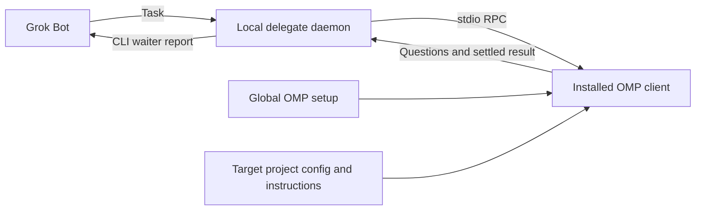

# bot-omp-delegate

Let Grok Bot delegate work to a resident local OMP worker, retain project context, steer or interrupt work, and wait for completion without repeated model turns.

Generic integration: each operator uses their own OMP installation, login, configuration and project files. Provider credentials are not bundled with the project.

## Requirements and setup

- macOS or Linux; Python 3.11+; installed, authenticated `omp` on PATH.
- No Python packages or JavaScript dependencies to install.
- Tested against OMP 18.14.1. Requires RPC v2 negotiation, `prompt_result`, `session_settled`, and `abort_and_restore_queue`.

```sh
git clone https://github.com/solomonyan/bot-omp-delegate.git
cd bot-omp-delegate
export PATH="$PWD/scripts:$PATH"
omp-delegate --help
omp-delegate daemon start
omp-delegate daemon status
```

Keep this directory in place; add the absolute `scripts` directory to your shell PATH for later use. In a supervisor, run `omp-delegate serve` in the foreground instead of `daemon start`. The detached daemon survives its launching shell, not a reboot. There is no automatic job replay or watchdog restart.

## Use with an existing project

Grok provides the task; the delegate starts the installed OMP client in the target project's working directory. OMP loads its own global setup and the project's configuration and instructions, performs the work, and returns questions or results through the delegate.



Run these commands on the machine that has both OMP and the target project:

```sh
PROJECT=/absolute/path/to/your-project

omp-delegate daemon start
omp-delegate session create --name grok-yourproject-coding --cwd "$PROJECT"

# Replace SESSION_ID with the id from the create response:
omp-delegate turn SESSION_ID \
  "Investigate the issue. Follow the project instructions, implement the fix and verify it. Do not commit or push."
```

Give Grok the absolute delegate CLI path, the target project path, the returned session ID, and the included [delegation skill](skills/bot-omp-delegate/SKILL.md). Grok sends subsequent tasks to the same session ID to retain that conversation's context.

This is a separate OMP conversation: it does not inherit an existing interactive chat's history or unsaved session overrides. It reuses discoverable configuration, not another chat's memory. A foreground waiter reports the result and escalates questions for a separate coordinator command to answer.

**Same-machine access is required by default.** Grok must be able to execute the CLI where OMP and the project reside. A cloud-only Grok Bot cannot automatically access OMP on your laptop. This project provides no remote tunnel; any remote execution connection must be separately configured and secured. Do not expose the daemon port publicly.

`turn` prints an initial JSON job record immediately, then blocks until the session settles. The final JSON contains `status`, `finalMessage`, `error`, session/job IDs and timestamps. It is JSONL, not one combined JSON document. Do not equate the initial `running` response with successful completion.

```sh
omp-delegate session list
omp-delegate turn SESSION_ID "Next task" --detach
omp-delegate read JOB_ID
omp-delegate wait JOB_ID --max-hours 6
omp-delegate events JOB_ID --after 0
omp-delegate steer JOB_ID "Preserve the existing public interface"
omp-delegate interrupt JOB_ID
omp-delegate session compact SESSION_ID
omp-delegate daemon stop
omp-delegate daemon restart
```

Event pagination uses a zero-based inclusive `--after`; pass the response's `next` as the following cursor. Events and private worker stderr logs persist under the state directory. There is no automatic transcript or job retention policy; monitor disk usage. Changed-file claims come from the worker's actual verification, not a daemon-generated Git status snapshot that would conflate pre-existing changes.

`wait` and foreground `turn` exit 0 for completed, 1 for an error, 2 for aborted/interrupted, 3 for the local wait deadline. At the deadline the job keeps running unless `--interrupt-at-deadline` is supplied. A disconnected waiter does not cancel or resubmit a job. Use `read`/`wait` with the original job ID.

## Reuse your OMP setup

Workers run the installed `omp` with its inherited environment and the target project's `--cwd`. OMP discovers global credentials, skills, extensions, custom tools and configured models, plus target-project configuration such as `.omp/config.yml` and instructions such as `AGENTS.md`. Project-local setup applies to that target project; it is not exported to unrelated projects. Provider credentials are neither copied into this repository nor returned to Grok by the delegate. An explicitly permitted tool can still access files available to the OS user; the delegate is not a credential-isolation sandbox.

Session creation accepts `--model`, `--thinking`, `--profile`, repeated `--config` and `--add-dir`, and `--tools`. Configuration/additional-directory paths must be absolute and already exist. Options are saved with the delegate session; create a differently named session to change them. A profile selects that profile's credentials/configuration, not the default profile's.

RPC pins some OMP defaults differently from interactive mode, notably task isolation/execution, memory, advisor and async behavior. Explicit OMP global/project configuration and overlays remain authoritative. This delegate preserves discovery; it does not promise that an RPC worker behaves identically to the current interactive chat. Tools needing interactive MCP login must be authenticated separately before delegation.

Environment variables:

| Variable | Purpose |
| --- | --- |
| `OMP_DELEGATE_STATE` | Private state directory; default `~/.omp-delegate` |
| `OMP_DELEGATE_PORT` | Loopback HTTP port; default `4510` |
| `OMP_DELEGATE_OMP` | OMP executable path; default `omp` |

`--state-dir` and `--port` precede the CLI subcommand and override their environment defaults. Daemon environment changes take effect after a restart.

## Approvals and questions

The default is `--approval-mode always-ask`, overriding a more permissive inherited approval tier. This is approval mediation, **not an OS sandbox**. OMP can access what its OS user can access when permitted; skills/extensions run with that user's permissions too. Do not expose this endpoint to untrusted coordinators or run untrusted extensions.

A waiting job reports `status: waiting_input` and `pendingInput`; foreground waiters print new questions to stderr. The coordinator answers from a separate CLI process:

```sh
# Tool approvals are select dialogs: use an exact option from pendingInput.
omp-delegate answer JOB_ID --json '{"id":"UI_REQUEST_ID","value":"Approve"}'
# Explicitly decline a confirm dialog:
omp-delegate answer JOB_ID --json '{"id":"UI_REQUEST_ID","confirmed":false}'
# Answer a structured ask dialog using the exact question IDs and option labels:
omp-delegate answer JOB_ID --json '{"id":"UI_REQUEST_ID","answers":[{"id":"db","selectedOptions":["SQLite"]}]}'
# Other OMP dialog forms accept value or cancelled, as appropriate:
omp-delegate answer JOB_ID --json '{"id":"UI_REQUEST_ID","cancelled":true}'
```

There is no auto-answer or auto-approval in the delegate. OMP's own dialog timeout behavior still applies; in particular an `ask` timeout can choose recommended/first options. See the pending request's timeout. To permit unattended changes, the owner can explicitly select `session create --approval-mode write` or `yolo`; those are broader authority, not sandbox modes. A waiter must alert its coordinator when input is needed rather than independently making approval/product decisions.

## Grok Bot workflow

Load [`skills/bot-omp-delegate/SKILL.md`](skills/bot-omp-delegate/SKILL.md) into Grok Bot's skills. Give Grok the installed absolute `omp-delegate` path and target project path.

One low-effort waiter subagent runs the blocking `turn` command in a foreground Shell call. If the platform returns a still-running shell handle, the waiter uses consecutive foreground waits on **that same handle**, not another turn submission. The main bot remains free and gets a single completion report. If a question appears, the waiter escalates it while preserving the active foreground wait.

This project does not install Grok, provision a cloud computer, tunnel to your Mac, or copy your OMP login to a cloud host. The daemon must run where OMP and the target files are accessible. A foreground waiter can keep a cloud platform active only if that platform counts foreground waits as activity; verify that behavior on your Grok environment. There is no portable promise that a detached process prevents machine sleep.

## Lifecycle and safety

- One active delegate job per resolved working directory, across all delegate sessions. Use separate clones/worktrees for parallel jobs. This cannot detect writers outside the delegate or all overlapping parent/child directories.
- Sessions and job snapshots are private durable JSON files. OMP transcripts live in each delegate session's `sessionDir` and remain resumable after daemon restarts.
- Only **settled** work is complete: a yielded agent can still have background jobs that wake it again. A new job is rejected until the previous session settles.
- After a crash, unfinished jobs are marked `interrupted` on restart. A graceful shutdown may let OMP report `aborted` first. Prompts are never silently replayed. Read the transcript and inspect actual work before resuming. Forced termination may leave OS descendants running; interruption and daemon shutdown are not a security kill switch.
- The daemon listens only on `127.0.0.1`, authenticates every route with a private bearer token, and rejects browser Origin headers. Never port-forward it publicly. The CLI reads the token internally; do not print or share it. Logs/transcripts may contain project data and prompts.
- CLI-to-daemon requests bypass HTTP proxy settings, keeping the local bearer token and task requests out of configured proxies. The OMP worker still inherits its environment, including proxy settings needed by its providers or tools.
- `interrupt` uses OMP's abort-and-restore-queue operation to prevent queued instructions from starting a fresh turn. Already scheduled external effects may still land. Verify the working directory before the next job.

## Publishing safely

Publish the source project, not its runtime state or a copy of your OMP home directory. The default state directory (`~/.omp-delegate`) is outside this repository. Keep any custom `--state-dir` outside the repository too: it contains the daemon token, project paths, prompts, tool output and session transcripts.

The `.gitignore` excludes common local environment files, credential/key files, logs, OMP-local state and Python caches. Ignore rules do not remove files already committed and do not prevent force-adding files. Review the staged files and scan the Git history before publishing; recheck after adding configuration, fixtures or logs.

Provider credentials stay with each operator's OMP installation. That is not a guarantee that runtime output is secret-free: prompts, tool output and extensions can expose sensitive data if permitted. Review any transcript or diagnostic attachment before sharing it.

## Development

```sh
python3 -m unittest discover -s tests -v
```

The public transport is authenticated HTTP, not Codex WebSocket JSON-RPC. `server.py` owns state and lifecycle; `worker.py` owns OMP's stdio framing, command correlation and child process; `cli.py` owns coordinator commands and foreground waits.
