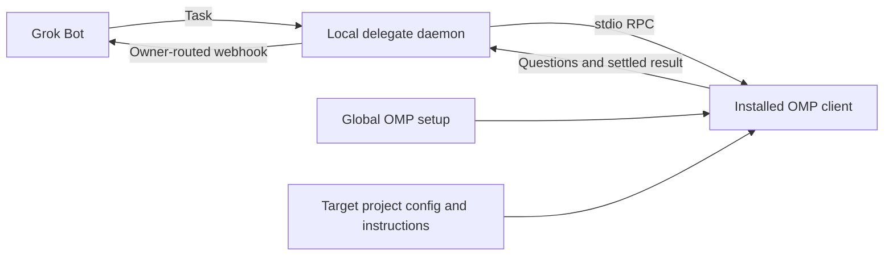

# bot-omp-delegate

Let Grok Bot delegate work to a resident local OMP worker, retain project context, steer or interrupt work, and wait for completion without repeated model turns.
Generic integration: each operator uses their own OMP installation, login, configuration and project files. Provider credentials are not bundled with the project.


## Outbound webhook notifications

Webhooks are best-effort asynchronous notifications, not a durable queue. Configure subscribers in the private `webhooks.json` under the delegate state directory; protect endpoint/auth/HMAC values and send only to trusted receivers. `events` and `lanes` filter operational notifications. Subscriber `mode` is `conversation` or `monitor` and defaults to `monitor` for existing observer compatibility.

Conversational events (`run.done`, `run.error`, `run.needs_input`) go only to the job's recorded `coordinator_subscriber_id`; owner selection overrides that subscriber's event/lane filters. Ownerless jobs remain available through `read`/`wait` and produce no conversational webhook. Set the coordinator subscriber to `mode: "conversation"` to keep operational events from waking Grok. Operational events (`run.deadline`, `run.stalled`, `lane.idle`, `daemon.up`) use normal event/lane filters and are delivered only to `monitor` subscribers. Notifications do not invoke a model or change OMP permissions.

Version 1 payloads include `channel` (`conversation` or `monitor`), `session_id`, `job_id`, and stable business `event_id`; terminal responses carry the full `message`, and questions carry `input_id` plus the full input request. The bounded `summary` is a diagnostic preview, not the response. Configured endpoint/auth/HMAC values are recursively redacted from user-visible string values, not structural keys or identifiers. `X-OMP-Delivery` remains stable across HTTP retries. Receivers should deduplicate by `event_id` before invoking Grok; HTTP delivery is best-effort and is not exactly-once. Verify configured HMAC signatures against raw request bytes before parsing.

Grok submits once with its coordinator subscriber ID, receives questions and answers them through the existing `answer` path, then receives the full final response. Continue follow-up work in the same session. Use a detached job plus webhook as the primary conversational path; `read`/`wait` are for inspection and recovery. Do not keep a foreground waiter and webhook both waking Grok, and do not wake the model for progress or operational events.

The daemon's delivery queue is bounded; shutdown or queue saturation can lose notifications, and receivers should use job state for recovery. For configuration schema, event semantics, and delivery limits, see [`skills/bot-omp-delegate/advanced.md`](skills/bot-omp-delegate/advanced.md).

Generic integration: each operator uses their own OMP installation, login, configuration and project files. Provider credentials are not bundled with the project.

## Requirements and setup

- macOS or Linux; Python 3.11+; installed, authenticated `omp` on PATH.
- No Python packages or JavaScript dependencies to install.
- Requires RPC v2 negotiation, `prompt_result`, `session_settled`, and `abort_and_restore_queue`. Conversation/approval smoke verified with installed OMP 18.18.2 and a local deterministic model; earlier model-backed verification used 18.14.1.

```sh
git clone https://github.com/solomonyan/bot-omp-delegate.git
cd bot-omp-delegate
export PATH="$PWD/scripts:$PATH"
omp-delegate --help
omp-delegate daemon start
omp-delegate daemon status
```

Keep this directory in place; add the absolute `scripts` directory to your shell PATH for later use. In a supervisor, run `omp-delegate serve` in the foreground instead of `daemon start`. The detached daemon survives its launching shell, not a reboot. There is no automatic job replay or watchdog restart.

Optional ticket-file dispatch uses `omp-dispatch LANE_ID /path/to/ticket.txt [max-hours]`.
The ticket must contain a non-empty `Must-have:` line. Set
`OMP_COORDINATOR_SUBSCRIBER_ID` to the job's webhook owner; `--caller NAME` adds
a caller label, and `--dry-run` previews the detached submission without dispatching.
The wrapper uses the sibling `omp-delegate` executable and preserves the session's
approval policy, including explicit `yolo`/`write` or inherited OMP defaults.
Change that policy with `omp-delegate session configure SESSION_ID --approval-mode yolo`
only when intended and the session is idle. Subscriber discovery and local monitoring
belong in private adapters, not this shared dispatcher.

## Use with an existing project

Grok provides the task; the delegate starts the installed OMP client in the target project's working directory. The Grok Mac app alone does not establish that it can execute local commands: use an executor with the CLI installed and access to the daemon, OMP, and project files. OMP loads its own global setup and project instructions, performs the work, and returns questions or results.



## Routine lane workflow

Create one lane per existing worktree. Lane creation records a fresh conversation without starting OMP:

```sh
PROJECT=/absolute/path/to/worktree
omp-delegate lane create --name project --cwd "$PROJECT"
omp-delegate lane list
omp-delegate lane show LANE_ID
omp-delegate lane run LANE_ID "Investigate and implement the requested change"
```

`lane run` returns a job handle, then waits in the foreground by default. Keep its ID for `read`, `wait`, `steer`, `answer`, or `interrupt`; use one waiter per job. `--detach` returns immediately. A closed available conversation automatically reopens on the next run. Completion retains the conversation; prompts are never replayed after interruption or daemon restart.

Foreground `lane run` and `turn` write an initial job record, then a final record: stdout is JSONL, not one combined JSON document. `wait` returns the final record. Exit codes are 0 completed, 1 error, 2 aborted/interrupted, and 3 waiter deadline. A deadline leaves work running unless `--interrupt-at-deadline` was explicitly selected. Reconnect using the original job handle; do not resubmit the task.

```sh
omp-delegate lane close LANE_ID
omp-delegate lane close LANE_ID --interrupt
omp-delegate lane new LANE_ID
```

Default close only closes an idle settled worker. Close preserves the conversation; `lane new` explicitly creates a fresh conversation after settlement and preserves old history. Use separate worktrees for parallel jobs.

### Native parent continuation

OMP delivers native `task` results into the same owning parent session and triggers its next turn in-process. The delegate keeps the worker, parent job and worktree ownership active when `prompt_result` has `sessionSettled: false`; it records the resumed parent's final message and finishes only after `session_settled`. Child completion alone is not a top-level completion webhook. No relay bot, second parent session or extra delegate prompt is involved.

`--continue` preserves conversation identity when reopening an idle worker; it is not the child-result wake mechanism. Interrupted tasks are not silently restored or replayed. Regression coverage uses an offline RPC peer to exercise the delegate boundary; no paid model-backed child-completion run is claimed.


Existing commands remain available: `session create/list/compact`, `turn SESSION MESSAGE`, `wait/read/events/steer/interrupt/answer JOB`. `turn` remains direct session dispatch; lanes are the routine interface.

## Advanced lifecycle

Use `session show/open/close/archive/unarchive/configure/delete ID` and `session list --archived` for explicit session operations. `open` optionally prewarms. Archive preserves history but disables dispatch; close leaves a conversation available for resumption. Configure while settled; reopened workers use the changed options without erasing history. `lane assign` requires `--expected-revision`; `lane delete` removes only its registration.

Deletion requires `--confirm-id` matching the session ID, and is restricted to archived, stopped, unassigned sessions. Purge affects delegate-owned session/job/event/log data, retaining minimal lane-history identity. It never deletes project files, worktrees, branches, provider history, credentials, or unrelated state. Filesystem removal is not secure erasure and cannot remove prior backups or exports.

Lane labels are coordination metadata, not authorization: clients sharing a daemon token share control. Subagent commands (`agent list/read/steer/cancel JOB ...`) use a parent job and child ID; cancellation is not a hard OS kill. Descendant cleanup depends on OMP support; detached tools, external effects, or unrelated processes may outlive shutdown.

## Upgrading existing state

Finish or explicitly interrupt existing jobs, stop the old daemon, update the code, then start the daemon with the same state directory and port. On first startup, legacy `sessions.json` is migrated into versioned `state.json`; session/job IDs, transcripts and options are preserved. The legacy metadata file is removed only after the new state is written. Existing sessions are not assigned to lanes automatically: create a lane and explicitly adopt a saved session with `lane assign` if needed.

Worker processes are runtime resources, not persisted conversations. After restart, workers start stopped and unfinished jobs remain interrupted/aborted; no prompts are replayed. Archived state and lane assignment/history persist. Failed cleanup keeps a worker quarantined rather than admitting a replacement writer. An interrupted purge is recovered on the next startup.

Do not run an older version against a migrated state directory: it does not understand the new metadata. There is no automatic idle timeout or transcript expiration. Grok decides when to close workers; deletion is a separate, explicit operation.

## Reuse your OMP setup

Workers run the installed `omp` with its inherited environment and the target project's `--cwd`. OMP discovers global credentials, skills, extensions, custom tools and configured models, plus target-project configuration such as `.omp/config.yml` and instructions such as `AGENTS.md`. Project-local setup applies to that target project; it is not exported to unrelated projects. Provider credentials are neither copied into this repository nor returned to Grok by the delegate. An explicitly permitted tool can still access files available to the OS user; the delegate is not a credential-isolation sandbox.

Session and lane creation accept `--model`, `--thinking`, `--profile`, repeated `--config` and `--add-dir`, and `--tools`. `--config` and `--add-dir` paths must be absolute and already exist; relative paths are rejected. Options are saved with the session; use `session configure ID` while settled to change them. A profile selects that profile's credentials/configuration, not the default profile's.

RPC pins some OMP defaults differently from interactive mode, notably task isolation/execution, memory, advisor and async behavior. Explicit OMP global/project configuration and overlays remain authoritative. This delegate preserves discovery; it does not promise that an RPC worker behaves identically to the current interactive chat. Tools needing interactive MCP login must be authenticated separately before delegation.

Environment variables:

| Variable | Purpose |
| --- | --- |
| `OMP_DELEGATE_STATE` | Private state directory; default `~/.omp-delegate` |
| `OMP_DELEGATE_PORT` | Loopback HTTP port; default `4510` |
| `OMP_DELEGATE_OMP` | OMP executable path; default `omp` |

`--state-dir` and `--port` precede the CLI subcommand and override their environment defaults. Daemon environment changes take effect after a restart.

## Approvals and questions

Workers inherit OMP's configured approval policy unless `approval_mode` is explicitly supplied. Existing explicit modes, including `write` and `yolo`, retain their meaning. Approval mediation is not an OS sandbox: OMP and its tools remain subject to the OS user's access. Never suppress an unresolved approval or grant permission on the coordinator's behalf.

A job with a pending request reports `status: waiting_input` and `pendingInput`. Conversational webhook delivery includes the full question request and `input_id`; Grok answers through the existing control path only after resolving the request under the owner's policy:

```sh
omp-delegate answer JOB_ID --json '{"id":"UI_REQUEST_ID","confirmed":false}'
omp-delegate answer JOB_ID --json '{"id":"UI_REQUEST_ID","answers":[{"id":"QUESTION_ID","selectedOptions":["EXACT OPTION"]}]}'
```

Use the exact request ID and values/options from `pendingInput`. OMP's own dialog timeout behavior still applies; for example, an `ask` timeout can select recommended/first options.

## Grok Bot workflow

Load [`skills/bot-omp-delegate/SKILL.md`](skills/bot-omp-delegate/SKILL.md) into Grok Bot's skills. Give Grok the installed absolute `omp-delegate` path and target project path. For conversational webhooks, configure its subscriber with `mode: "conversation"` and pass that ID as `--coordinator-subscriber-id` when submitting a detached job. Submit once; Grok handles a question via `answer`, receives the full final response, and continues in the same session. Use `read`/`wait` to inspect or recover a job, not as a second foreground conversational wake path.

The Grok Mac app does not imply local shell access. Run the delegate in an executor that can reach the local daemon, OMP installation, and worktree.


## Lifecycle and safety

- One active delegate job per resolved working directory, across all delegate sessions. Use separate clones/worktrees for parallel jobs. This cannot detect writers outside the delegate or all overlapping parent/child directories.
- Sessions and job snapshots are private durable JSON files. OMP transcripts live in each delegate session's `sessionDir` and remain resumable after daemon restarts.
- Only **settled** work is complete: a yielded agent can still have background jobs that wake it again. A new job is rejected until the previous session settles.
- After a crash, unfinished jobs are marked `interrupted` on restart. A graceful shutdown may let OMP report `aborted` first. Prompts are never silently replayed. Read the transcript and inspect actual work before resuming. Forced termination may leave OS descendants running; interruption and daemon shutdown are not a security kill switch.
- The daemon listens only on `127.0.0.1`, authenticates every route with a private bearer token, and rejects browser Origin headers. Never port-forward it publicly. The CLI reads the token internally; do not print or share it. Logs/transcripts may contain project data and prompts.
- CLI-to-daemon requests bypass HTTP proxy settings, keeping the local bearer token and task requests out of configured proxies. The OMP worker still inherits its environment, including proxy settings needed by its providers or tools.
- `interrupt` uses OMP's abort-and-restore-queue operation to prevent queued instructions from starting a fresh turn. Already scheduled external effects may still land. Verify the working directory before the next job.

## Publishing safely

Publish the source project, not its runtime state or a copy of your OMP home directory. The default state directory (`~/.omp-delegate`) is outside this repository. Keep any custom `--state-dir` outside the repository too: it contains the daemon token, project paths, prompts, tool output and session transcripts.

The `.gitignore` excludes common local environment files, credential/key files, logs, OMP-local state and Python caches. Ignore rules do not remove files already committed and do not prevent force-adding files. Review the staged files and scan the Git history before publishing; recheck after adding configuration, fixtures or logs.

Provider credentials stay with each operator's OMP installation. That is not a guarantee that runtime output is secret-free: prompts, tool output and extensions can expose sensitive data if permitted. Review any transcript or diagnostic attachment before sharing it.


## Development

```sh
python3 -m unittest discover -s tests -v
```

