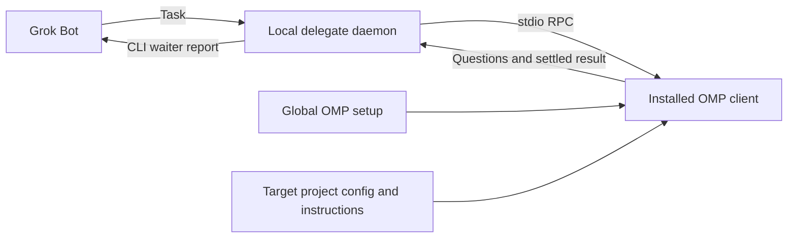

# bot-omp-delegate

Let Grok Bot delegate work to a resident local OMP worker, retain project context, steer or interrupt work, and wait for completion without repeated model turns.
Generic integration: each operator uses their own OMP installation, login, configuration and project files. Provider credentials are not bundled with the project.


## Outbound webhook notifications

The daemon can send best-effort HTTP notifications for lifecycle events. Notifications are delivered asynchronously; they do not block lane work. A full delivery queue drops notifications, and transient failures receive bounded retries. Delivery is not durable: daemon shutdown or a process failure can lose queued events, while retries can produce duplicate requests. Consumers should deduplicate by `X-OMP-Delivery`.

### Private configuration and provisioning

Webhook configuration is stored in `webhooks.json` under the delegate state directory (by default `~/.omp-delegate`, or the directory selected by `--state-dir`). Keep the state directory private. The configuration file is owner-owned, regular, and mode `0600`; the daemon rejects symlinks and insecure permissions. Timer settings (`stall_seconds` and nullable `idle_seconds`) are configured directly in this private JSON file. The `webhook list` command reveals safe subscriber metadata only; it redacts URLs and never displays authentication or signing values.

Provision one subscriber at a time by piping one JSON object to standard input. Keep the URL and secret values out of shell arguments, command history, and interactive echoed input:

```sh
printf '%s\n' '{"id":"ops","url":"https://receiver.example/events","auth_header":"Authorization","auth_value":"<private value>","hmac_secret":"<private signing secret>"}' |
  omp-delegate webhook add
omp-delegate webhook list
omp-delegate webhook test
omp-delegate webhook remove ops
```

Replace the illustrative endpoint and placeholders locally; do not put real credentials in scripts or documentation. Subscribers require an ID and an HTTP(S) URL. HTTP is permitted only for loopback receivers. Optional fields include `auth_header`, `auth_value`, `hmac_secret`, `signature_header`, `events`, and `lanes`. The default signature header is `X-OMP-Signature`. `webhook add --id ID` sets or overrides the non-secret subscriber ID. Duplicate IDs are rejected rather than silently replaced.

Changes are saved locally first. The CLI then attempts a runtime reload; if the daemon is unavailable or does not support the reload route, the saved configuration remains in place and takes effect when the daemon next starts. `webhook test [--event daemon.up]` sends an explicit connectivity test that bypasses subscriber filters and reports sanitized delivery receipts; it exits successfully when there are no subscribers or all attempted deliveries succeed.

### Events, filters and delivery

Events describe lifecycle facts: `daemon.up`, `run.done`, `run.error`, `run.needs_input`, `run.stalled`, `run.deadline`, and optional `lane.idle`. A waiter deadline means the waiter stopped waiting; it does not mean the task was cancelled. Stall means no new output for the configured interval, not proof of deadlock. Notifications do not invoke a model or alter task policy.

An `events` filter selects event names; a `lanes` filter selects lane names or lane IDs. Omitted filters receive all applicable events. Lane and job fields are empty for daemon-level events and unassigned sessions. `run.needs_input` is emitted once for a newly pending input request; stall alerts are suppressed until output resumes, then may fire again. Deadline alerts do not cancel work.

Requests are JSON with an `X-OMP-Event` header and stable `X-OMP-Delivery` identifier across retries. When `hmac_secret` is configured, the signature header carries `sha256=` followed by the hexadecimal HMAC-SHA256 of the exact request body bytes. Receivers should verify the signature against the raw body before parsing JSON and deduplicate retries using the delivery identifier. Authentication headers are optional and configured per subscriber.

The daemon retries transient network failures and non-2xx responses with bounded backoff. It avoids redirects and environment-configured proxies; response bodies and credential-bearing values are not exposed in CLI receipts. Notifications are an operational convenience, not a durable event log or a replacement for querying job state.

For the complete event payload, configuration schema, and operational limits, see [`skills/bot-omp-delegate/advanced.md`](skills/bot-omp-delegate/advanced.md).
Generic integration: each operator uses their own OMP installation, login, configuration and project files. Provider credentials are not bundled with the project.

## Requirements and setup

- macOS or Linux; Python 3.11+; installed, authenticated `omp` on PATH.
- No Python packages or JavaScript dependencies to install.
- Tested against OMP 18.14.1. Requires RPC v2 negotiation, `prompt_result`, `session_settled`, and `abort_and_restore_queue`.

```sh
git clone https://github.com/solomonyan/bot-omp-delegate.git
cd bot-omp-delegate
export PATH="$PWD/scripts:$PATH"
omp-delegate --help
omp-delegate daemon start
omp-delegate daemon status
```

Keep this directory in place; add the absolute `scripts` directory to your shell PATH for later use. In a supervisor, run `omp-delegate serve` in the foreground instead of `daemon start`. The detached daemon survives its launching shell, not a reboot. There is no automatic job replay or watchdog restart.

## Use with an existing project

Grok provides the task; the delegate starts the installed OMP client in the target project's working directory. The Grok Mac app alone does not establish that it can execute local commands: use an executor with the CLI installed and access to the daemon, OMP, and project files. OMP loads its own global setup and project instructions, performs the work, and returns questions or results.



## Routine lane workflow

Create one lane per existing worktree. Lane creation records a fresh conversation without starting OMP:

```sh
PROJECT=/absolute/path/to/worktree
omp-delegate lane create --name project --cwd "$PROJECT"
omp-delegate lane list
omp-delegate lane show LANE_ID
omp-delegate lane run LANE_ID "Investigate and implement the requested change"
```

`lane run` returns a job handle, then waits in the foreground by default. Keep its ID for `read`, `wait`, `steer`, `answer`, or `interrupt`; use one waiter per job. `--detach` returns immediately. A closed available conversation automatically reopens on the next run. Completion retains the conversation; prompts are never replayed after interruption or daemon restart.

Foreground `lane run` and `turn` write an initial job record, then a final record: stdout is JSONL, not one combined JSON document. `wait` returns the final record. Exit codes are 0 completed, 1 error, 2 aborted/interrupted, and 3 waiter deadline. A deadline leaves work running unless `--interrupt-at-deadline` was explicitly selected. Reconnect using the original job handle; do not resubmit the task.

```sh
omp-delegate lane close LANE_ID
omp-delegate lane close LANE_ID --interrupt
omp-delegate lane new LANE_ID
```

Default close only closes an idle settled worker. Close preserves the conversation; `lane new` explicitly creates a fresh conversation after settlement and preserves old history. Use separate worktrees for parallel jobs.

The daemon can send best-effort HTTP notifications for lifecycle events. Notifications are delivered asynchronously; they do not block lane work. A full delivery queue drops notifications, and transient failures receive bounded retries. Delivery is not durable: daemon shutdown or a process failure can lose queued events, while retries can produce duplicate requests. Consumers should deduplicate by `X-OMP-Delivery`.

### Private configuration and provisioning

Webhook configuration is stored in `webhooks.json` under the delegate state directory (by default `~/.omp-delegate`, or the directory selected by `--state-dir`). Keep the state directory private. The configuration file is owner-owned, regular, and mode `0600`; the daemon rejects symlinks and insecure permissions. Timer settings (`stall_seconds` and nullable `idle_seconds`) are configured directly in this private JSON file. The `webhook list` command reveals safe subscriber metadata only; it redacts URLs and never displays authentication or signing values.

Provision one subscriber at a time by piping one JSON object to standard input. Keep the URL and secret values out of shell arguments, command history, and interactive echoed input:

```sh
printf '%s\n' '{"id":"ops","url":"https://receiver.example/events","auth_header":"Authorization","auth_value":"<private value>","hmac_secret":"<private signing secret>"}' |
  omp-delegate webhook add
omp-delegate webhook list
omp-delegate webhook test
omp-delegate webhook remove ops
```

Replace the illustrative endpoint and placeholders locally; do not put real credentials in scripts or documentation. Subscribers require an ID and an HTTP(S) URL. HTTP is permitted only for loopback receivers. Optional fields include `auth_header`, `auth_value`, `hmac_secret`, `signature_header`, `events`, and `lanes`. The default signature header is `X-OMP-Signature`. `webhook add --id ID` sets or overrides the non-secret subscriber ID. Duplicate IDs are rejected rather than silently replaced.

Changes are saved locally first. The CLI then attempts a runtime reload; if the daemon is unavailable or does not support the reload route, the saved configuration remains in place and takes effect when the daemon next starts. `webhook test [--event daemon.up]` sends an explicit connectivity test that bypasses subscriber filters and reports sanitized delivery receipts; it exits successfully when there are no subscribers or all attempted deliveries succeed.

### Events, filters and delivery

Events describe lifecycle facts: `daemon.up`, `run.done`, `run.error`, `run.needs_input`, `run.stalled`, `run.deadline`, and optional `lane.idle`. A waiter deadline means the waiter stopped waiting; it does not mean the task was cancelled. Stall means no new output for the configured interval, not proof of deadlock. Notifications do not invoke a model or alter task policy.

An `events` filter selects event names; a `lanes` filter selects lane names or lane IDs. Omitted filters receive all applicable events. Lane and job fields are empty for daemon-level events and unassigned sessions. `run.needs_input` is emitted once for a newly pending input request; stall alerts are suppressed until output resumes, then may fire again. Deadline alerts do not cancel work.

Requests are JSON with an `X-OMP-Event` header and stable `X-OMP-Delivery` identifier across retries. When `hmac_secret` is configured, the signature header carries `sha256=` followed by the hexadecimal HMAC-SHA256 of the exact request body bytes. Receivers should verify the signature against the raw body before parsing JSON and deduplicate retries using the delivery identifier. Authentication headers are optional and configured per subscriber.

The daemon retries transient network failures and non-2xx responses with bounded backoff. It avoids redirects and environment-configured proxies; response bodies and credential-bearing values are not exposed in CLI receipts. Notifications are an operational convenience, not a durable event log or a replacement for querying job state.

For the complete event payload, configuration schema, and operational limits, see [`skills/bot-omp-delegate/advanced.md`](skills/bot-omp-delegate/advanced.md).

Existing commands remain available: `session create/list/compact`, `turn SESSION MESSAGE`, `wait/read/events/steer/interrupt/answer JOB`. `turn` remains direct session dispatch; lanes are the routine interface.

## Advanced lifecycle

Use `session show/open/close/archive/unarchive/configure/delete ID` and `session list --archived` for explicit session operations. `open` optionally prewarms. Archive preserves history but disables dispatch; close leaves a conversation available for resumption. Configure while settled; reopened workers use the changed options without erasing history. `lane assign` requires `--expected-revision`; `lane delete` removes only its registration.

Deletion requires `--confirm-id` matching the session ID, and is restricted to archived, stopped, unassigned sessions. Purge affects delegate-owned session/job/event/log data, retaining minimal lane-history identity. It never deletes project files, worktrees, branches, provider history, credentials, or unrelated state. Filesystem removal is not secure erasure and cannot remove prior backups or exports.

Lane labels are coordination metadata, not authorization: clients sharing a daemon token share control. Subagent commands (`agent list/read/steer/cancel JOB ...`) use a parent job and child ID; cancellation is not a hard OS kill. Descendant cleanup depends on OMP support; detached tools, external effects, or unrelated processes may outlive shutdown.

## Upgrading existing state

Finish or explicitly interrupt existing jobs, stop the old daemon, update the code, then start the daemon with the same state directory and port. On first startup, legacy `sessions.json` is migrated into versioned `state.json`; session/job IDs, transcripts and options are preserved. The legacy metadata file is removed only after the new state is written. Existing sessions are not assigned to lanes automatically: create a lane and explicitly adopt a saved session with `lane assign` if needed.

Worker processes are runtime resources, not persisted conversations. After restart, workers start stopped and unfinished jobs remain interrupted/aborted; no prompts are replayed. Archived state and lane assignment/history persist. Failed cleanup keeps a worker quarantined rather than admitting a replacement writer. An interrupted purge is recovered on the next startup.

Do not run an older version against a migrated state directory: it does not understand the new metadata. There is no automatic idle timeout or transcript expiration. Grok decides when to close workers; deletion is a separate, explicit operation.

## Reuse your OMP setup

Workers run the installed `omp` with its inherited environment and the target project's `--cwd`. OMP discovers global credentials, skills, extensions, custom tools and configured models, plus target-project configuration such as `.omp/config.yml` and instructions such as `AGENTS.md`. Project-local setup applies to that target project; it is not exported to unrelated projects. Provider credentials are neither copied into this repository nor returned to Grok by the delegate. An explicitly permitted tool can still access files available to the OS user; the delegate is not a credential-isolation sandbox.

Session and lane creation accept `--model`, `--thinking`, `--profile`, repeated `--config` and `--add-dir`, and `--tools`. `--config` and `--add-dir` paths must be absolute and already exist; relative paths are rejected. Options are saved with the session; use `session configure ID` while settled to change them. A profile selects that profile's credentials/configuration, not the default profile's.

RPC pins some OMP defaults differently from interactive mode, notably task isolation/execution, memory, advisor and async behavior. Explicit OMP global/project configuration and overlays remain authoritative. This delegate preserves discovery; it does not promise that an RPC worker behaves identically to the current interactive chat. Tools needing interactive MCP login must be authenticated separately before delegation.

Environment variables:

| Variable | Purpose |
| --- | --- |
| `OMP_DELEGATE_STATE` | Private state directory; default `~/.omp-delegate` |
| `OMP_DELEGATE_PORT` | Loopback HTTP port; default `4510` |
| `OMP_DELEGATE_OMP` | OMP executable path; default `omp` |

`--state-dir` and `--port` precede the CLI subcommand and override their environment defaults. Daemon environment changes take effect after a restart.

## Approvals and questions

The default is `--approval-mode always-ask`, overriding a more permissive inherited approval tier. This is approval mediation, **not an OS sandbox**. OMP can access what its OS user can access when permitted; skills/extensions run with that user's permissions too. Do not expose this endpoint to untrusted coordinators or run untrusted extensions.

A waiting job reports `status: waiting_input` and `pendingInput`; foreground waiters print new questions to stderr. The coordinator answers from a separate CLI process:

```sh
# Tool approvals are select dialogs: use an exact option from pendingInput.
omp-delegate answer JOB_ID --json '{"id":"UI_REQUEST_ID","value":"Approve"}'
# Explicitly decline a confirm dialog:
omp-delegate answer JOB_ID --json '{"id":"UI_REQUEST_ID","confirmed":false}'
# Answer a structured ask dialog using the exact question IDs and option labels:
omp-delegate answer JOB_ID --json '{"id":"UI_REQUEST_ID","answers":[{"id":"db","selectedOptions":["SQLite"]}]}'
# Other OMP dialog forms accept value or cancelled, as appropriate:
omp-delegate answer JOB_ID --json '{"id":"UI_REQUEST_ID","cancelled":true}'
```

There is no auto-answer or auto-approval in the delegate. OMP's own dialog timeout behavior still applies; in particular an `ask` timeout can choose recommended/first options. The coordinator resolves questions or obtains owner approval before answering. See the pending request timeout. To permit unattended changes, the owner can explicitly select `session create --approval-mode write` or `yolo`; those are broader authority, not sandbox modes. A waiter escalates input needs and makes no approval/product decisions.

## Grok Bot workflow

Load [`skills/bot-omp-delegate/SKILL.md`](skills/bot-omp-delegate/SKILL.md) into Grok Bot's skills. Give Grok the installed absolute `omp-delegate` path and target project path.

One low-effort waiter subagent runs the blocking `lane run` command in a foreground Shell call. If the platform returns a still-running shell handle, the waiter uses consecutive foreground waits on **that same handle**, not another turn submission. The main bot remains free and gets a single completion report. If a question appears, the waiter escalates it while preserving the active foreground wait.

The Grok Mac app does not imply local shell access. Run the waiter in an executor that has this CLI and can reach the local daemon, OMP installation, and worktree.

## Lifecycle and safety

- One active delegate job per resolved working directory, across all delegate sessions. Use separate clones/worktrees for parallel jobs. This cannot detect writers outside the delegate or all overlapping parent/child directories.
- Sessions and job snapshots are private durable JSON files. OMP transcripts live in each delegate session's `sessionDir` and remain resumable after daemon restarts.
- Only **settled** work is complete: a yielded agent can still have background jobs that wake it again. A new job is rejected until the previous session settles.
- After a crash, unfinished jobs are marked `interrupted` on restart. A graceful shutdown may let OMP report `aborted` first. Prompts are never silently replayed. Read the transcript and inspect actual work before resuming. Forced termination may leave OS descendants running; interruption and daemon shutdown are not a security kill switch.
- The daemon listens only on `127.0.0.1`, authenticates every route with a private bearer token, and rejects browser Origin headers. Never port-forward it publicly. The CLI reads the token internally; do not print or share it. Logs/transcripts may contain project data and prompts.
- CLI-to-daemon requests bypass HTTP proxy settings, keeping the local bearer token and task requests out of configured proxies. The OMP worker still inherits its environment, including proxy settings needed by its providers or tools.
- `interrupt` uses OMP's abort-and-restore-queue operation to prevent queued instructions from starting a fresh turn. Already scheduled external effects may still land. Verify the working directory before the next job.

## Publishing safely

Publish the source project, not its runtime state or a copy of your OMP home directory. The default state directory (`~/.omp-delegate`) is outside this repository. Keep any custom `--state-dir` outside the repository too: it contains the daemon token, project paths, prompts, tool output and session transcripts.

The `.gitignore` excludes common local environment files, credential/key files, logs, OMP-local state and Python caches. Ignore rules do not remove files already committed and do not prevent force-adding files. Review the staged files and scan the Git history before publishing; recheck after adding configuration, fixtures or logs.

Provider credentials stay with each operator's OMP installation. That is not a guarantee that runtime output is secret-free: prompts, tool output and extensions can expose sensitive data if permitted. Review any transcript or diagnostic attachment before sharing it.

## Outbound webhook notifications

The daemon can send best-effort HTTP notifications for lifecycle events. Notifications are delivered asynchronously; they do not block lane work. A full delivery queue drops notifications, and transient failures receive bounded retries. Delivery is not durable: daemon shutdown or a process failure can lose queued events, while retries can produce duplicate requests. Consumers should deduplicate by `X-OMP-Delivery`.

### Private configuration and provisioning

Webhook configuration is stored in `webhooks.json` under the delegate state directory (by default `~/.omp-delegate`, or the directory selected by `--state-dir`). Keep the state directory private. The configuration file is owner-owned, regular, and mode `0600`; the daemon rejects symlinks and insecure permissions. Timer settings (`stall_seconds` and nullable `idle_seconds`) are configured directly in this private JSON file. The `webhook list` command reveals safe subscriber metadata only; it redacts URLs and never displays authentication or signing values.

Provision one subscriber at a time from a private JSON file or a secret-manager pipe. Keep endpoint and secret values out of shell arguments, command history, and interactive echoed input:

```sh
# Create this subscriber object with your secret manager/editor, mode 0600.
omp-delegate webhook add < /private/path/subscriber.json
omp-delegate webhook list
omp-delegate webhook test
omp-delegate webhook remove ops
```

Replace the illustrative endpoint and placeholders locally; do not put real credentials in scripts or documentation. Subscribers require an ID and an HTTP(S) URL. HTTP is permitted only for loopback receivers. Optional fields include `auth_header`, `auth_value`, `hmac_secret`, `signature_header`, `events`, and `lanes`. The default signature header is `X-OMP-Signature`. `webhook add --id ID` sets or overrides the non-secret subscriber ID. Duplicate IDs are rejected rather than silently replaced.

Changes are saved locally first. The CLI then attempts a runtime reload; if the daemon is unavailable or does not support the reload route, the saved configuration remains in place and takes effect when the daemon next starts. `webhook test [--event daemon.up]` sends an explicit connectivity test that bypasses subscriber filters and reports sanitized delivery receipts; it exits successfully when there are no subscribers or all attempted deliveries succeed.

Timer edits in `webhooks.json` apply after a reload or restart. Use `omp-delegate daemon restart --idle-only` once all work is settled; it atomically rejects a busy daemon and prevents new dispatch during shutdown. Older daemons without this capability require the coordinator to stop submitting work before their initial upgrade.

### Events, filters and delivery

Events describe lifecycle facts: `daemon.up`, `run.done`, `run.error`, `run.needs_input`, `run.stalled`, `run.deadline`, and optional `lane.idle`. A waiter deadline means the waiter stopped waiting; it does not mean the task was cancelled. Stall means no new output for the configured interval, not proof of deadlock. Notifications do not invoke a model or alter task policy.

An `events` filter selects event names; a `lanes` filter selects lane names or lane IDs. Omitted or empty filters receive all applicable events. Lane fields are empty for unassigned sessions; daemon events also have empty job fields. `run.needs_input` is emitted once per pending dialog ID. `run.stalled` defaults to 30 minutes without observed output, is suppressed during questions/approvals, and rearms when output resumes. `lane.idle` is disabled by default. Deadline alerts are once per live job and do not cancel work. Add optional coordination metadata with `lane run ... --label OPS-42`.

Requests are JSON with an `X-OMP-Event` header and stable `X-OMP-Delivery` identifier across retries. When `hmac_secret` is configured, the signature header carries `sha256=` followed by the hexadecimal HMAC-SHA256 of the exact request body bytes. Receivers should verify the signature against the raw body before parsing JSON and deduplicate retries using the delivery identifier. Authentication headers are optional and configured per subscriber.

Each delivery receives an initial attempt plus three retries, after 1, 2 and 4 seconds. Up to four workers use bounded request timeouts and a 256-entry queue; failures never block or kill a lane. Requests do not follow redirects or use environment-configured proxies. CLI receipts omit response bodies, endpoints and credentials. Payloads include project paths, Git metadata and a short output/error summary: configure only trusted receivers. This is not a general-purpose secret scanner or a durable event log; job state remains authoritative.

For the complete event payload, configuration schema, and operational limits, see [`skills/bot-omp-delegate/advanced.md`](skills/bot-omp-delegate/advanced.md).

## Development

```sh
python3 -m unittest discover -s tests -v
```

